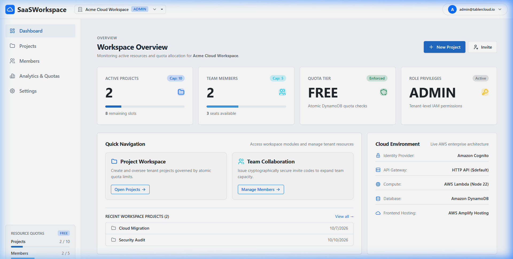
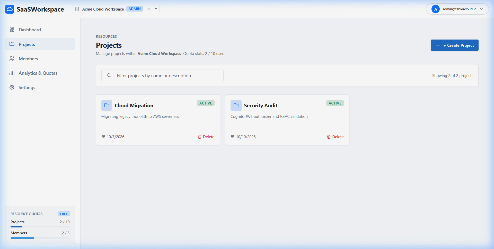
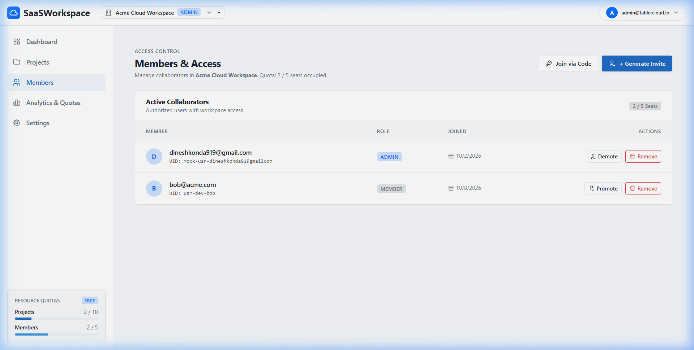
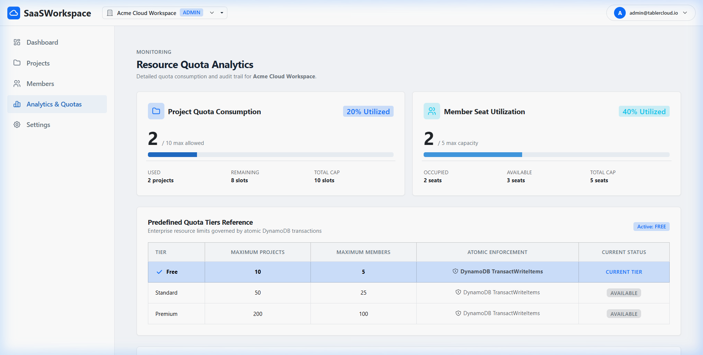
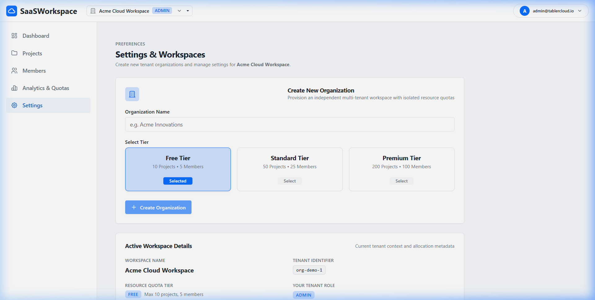
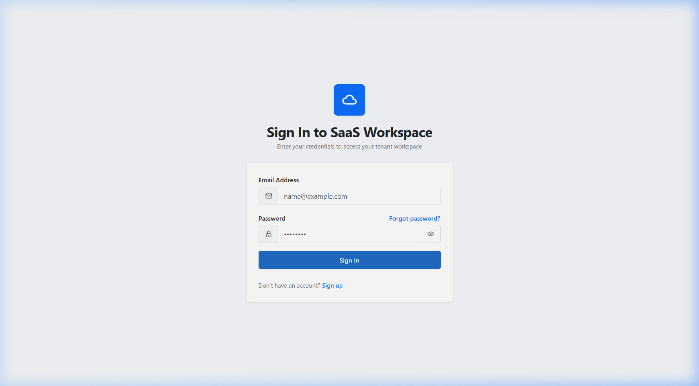
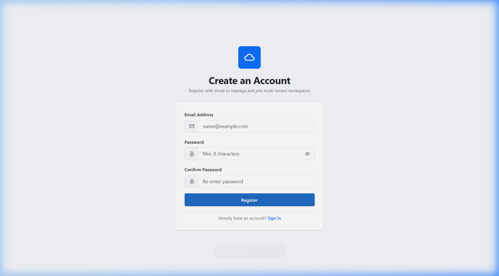
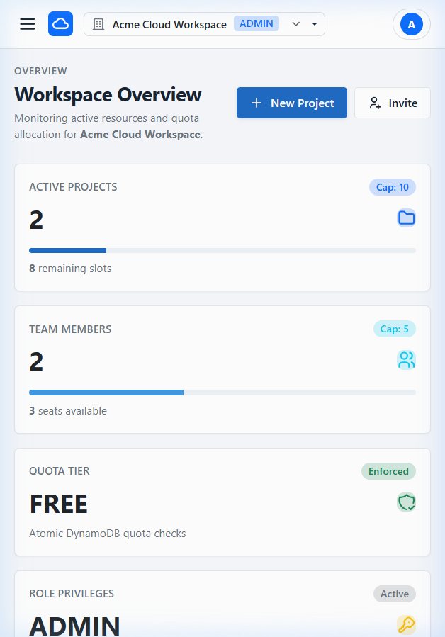
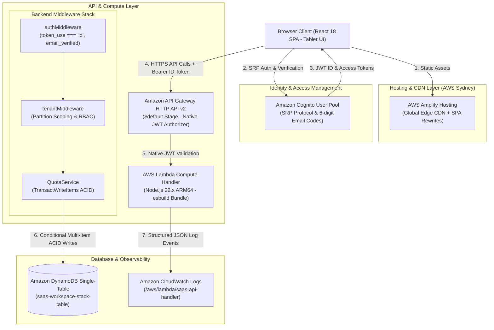

# Multi-Tenant SaaS Workspace with Resource Quota Management

[-FF9900?logo=amazon-aws&logoColor=white)](https://aws.amazon.com/serverless/sam/)
[](https://main.d2h2pxsqugbcgb.amplifyapp.com/)
[-DD344C?logo=amazon-aws&logoColor=white)](https://aws.amazon.com/cognito/)
[](https://aws.amazon.com/dynamodb/)
[](https://nodejs.org/)
[](https://react.dev/)
[](https://tabler.io/)
[-success?logo=vitest&logoColor=white)](#testing-and-quality-assurance)
[](LICENSE)

> A production-grade, cloud-native Multi-Tenant Software-as-a-Service (SaaS) Workspace demonstrating partition-level tenant data isolation, server-side atomic resource quota enforcement via DynamoDB ACID transactions, Secure Remote Password (SRP) authentication via Amazon Cognito, and a modern Tabler UI design system deployed entirely on Amazon Web Services (AWS Sydney).

---

## 🌐 Live Production Links

- **Live Application (AWS Amplify Hosting):** [https://main.d2h2pxsqugbcgb.amplifyapp.com](https://main.d2h2pxsqugbcgb.amplifyapp.com/)
- **Live API Base Endpoint (API Gateway HTTP API v2):** `https://sdu2useqyb.execute-api.ap-southeast-2.amazonaws.com/api/v1`
- **Target AWS Deployment Region:** AWS Asia Pacific (Sydney), `ap-southeast-2`

---

## 📑 Table of Contents

- [Project Overview](#project-overview)
- [Problem Statement](#problem-statement)
- [Key Features](#key-features)
- [Visual Demonstration & Screenshots](#visual-demonstration--screenshots)
- [Live Demo Access](#live-demo-access)
- [System Architecture](#system-architecture)
- [Technology Stack](#technology-stack)
- [Existing AWS Services vs. Custom Engineering](#existing-aws-services-vs-custom-engineering)
- [Resource Quota Design & Concurrency Handling](#resource-quota-design--concurrency-handling)
- [Security & Tenant Isolation Model](#security--tenant-isolation-model)
- [Local Development Setup](#local-development-setup)
- [Testing and Quality Assurance](#testing-and-quality-assurance)
- [Deployment Guide](#deployment-guide)
- [Limitations & Future Roadmap](#limitations--future-roadmap)
- [License & Acknowledgments](#license--acknowledgments)

---

## Project Overview

In enterprise cloud computing, building scalable Software-as-a-Service (SaaS) applications requires balancing two competing demands: maximizing resource sharing to minimize infrastructure overhead while strictly enforcing tenant isolation and resource consumption boundaries.

**SaaSWorkspace** is a full-stack, cloud-native SaaS application designed to demonstrate robust multi-tenancy patterns on AWS serverless infrastructure:
1. **Multi-Tenancy via Single-Table Architecture:** Multiple client organizations operate within a unified Amazon DynamoDB table. Tenant isolation is achieved through logical partition key scoping (`ORG#<orgId>`), eliminating the operational complexity and cost of provisioning separate databases per tenant.
2. **Server-Side Atomic Quota Enforcement:** Resource quotas (maximum projects and maximum team members per workspace) are strictly enforced at the database layer using DynamoDB `TransactWriteItems` with condition expressions. This eliminates race conditions during concurrent user requests and prevents noisy-neighbor resource monopolization.
3. **End-to-End AWS Serverless Ecosystem:** Zero persistent EC2 instances or container clusters to manage. The architecture scales automatically from zero to thousands of concurrent requests across AWS Amplify Hosting, Amazon API Gateway HTTP API v2, AWS Lambda (Node.js 22.x ARM64), and Amazon DynamoDB.

**Intended Users:** Engineering managers, cross-functional project teams, and enterprise administrators requiring isolated workspaces, role-based member collaboration, and real-time quota visibility.

---

## Problem Statement

Developing a robust multi-tenant cloud application presents fundamental engineering challenges:

| Engineering Challenge | Naive / Vulnerable Approach | SaaSWorkspace Architectural Solution |
|:---|:---|:---|
| **Tenant Data Leakage** | Separate database per tenant (prohibitive cost) or client-filtered queries (security risk) | **Partition Key Isolation:** Partition keys prefixed with `ORG#<orgId>`. DynamoDB structurally prevents cross-tenant record retrieval without authorization. |
| **Quota Race Conditions** | Read current count from DB, check in application memory, then write (susceptible to concurrent double-spending) | **ACID Transactions:** DynamoDB `TransactWriteItems` executes item creation and counter increment atomically with condition expressions (`projectCount < maxProjects`). |
| **Token Spoofing & Email Verification** | Accepting any valid JWT or trusting client-side authentication flags | **Claims Inspection Middleware:** API Gateway verifies cryptographic JWT signature against Cognito JWKS; Lambda middleware verifies `token_use === 'id'` and `email_verified === 'true'`. |
| **Orphaned Resources on Deletion** | Deleting the parent organization item, leaving projects, invites, and members stranded | **Resumable 7-Step Cascading Deletion Engine:** Locks the organization in `DELETING` status, executes chunked `BatchWriteItem` purges, and verifies zero orphans before final metadata removal. |
| **Infrastructure Scalability & Costs** | Always-on virtual machines incurring continuous idle expenses | **100% Serverless Scale-to-Zero:** Lambda, API Gateway, DynamoDB on-demand, and Amplify Hosting edge CDN incur negligible or zero charges when idle. |

---

## Key Features

### 🔐 Authentication & Identity Management
- **Amazon Cognito SRP Integration:** Secure Remote Password (SRP) protocol via AWS Amplify Auth v6; passwords are never transmitted across the network in plaintext.
- **Mandatory Email Verification:** Self-service public registration issuing a 6-digit confirmation code via Amazon Cognito. Unconfirmed accounts cannot execute authenticated workspace APIs.
- **Session Management:** Refresh token rotation and automatic session expiration handling.

### 🏢 Multi-Tenant Workspace & Organization Lifecycle
- **Workspace Creation & Switching:** Users can create multiple organizations or belong to multiple workspaces with seamless tenant context switching.
- **Tier Assignment:** Tiers (Free, Standard, Premium) automatically set resource ceilings.
- **Role-Based Access Control (RBAC):** Organization-scoped roles (`ADMIN` vs `MEMBER`) govern workspace actions.
- **Last-Admin Safeguard:** Conditional expressions (`adminCount > 1`) prevent organizations from accidentally demoting or deleting their sole administrator.

### 📁 Project Management & CRUD Operations
- **Project Workspaces:** Full project lifecycle management (creation, listing, updating, deletion) within tenant boundaries.
- **Metadata Tracking:** Creation timestamps, modification history, and creator user association.

### 👥 Member Roster & Invitation Engine
- **Secure Member Invites:** Administrative generation of 8-character invite codes with role pre-assignment and expiration timestamps.
- **Invitation Acceptance:** Authenticated users redeem invite codes to join organizations with automatic GSI index population.
- **Member Roster Management:** Role updates and member removal with atomic counter tracking.

### ⚡ Server-Side Atomic Quota Enforcement
- **ACID Transaction Engine:** Multi-item conditional writes execute project creation and counter increments in a single atomic transaction.
- **Concurrency Protection:** Concurrent requests attempting to exceed quota limits are safely rejected with HTTP 403 `QuotaExceededError`.

### 📊 Real-Time Quota Analytics
- **Visual Capacity Gauges:** Tabler UI progress bars display real-time percentage consumption of project and member quotas.
- **Tier Status & Ceilings:** Clear visibility into current plan limits and utilization trends.

### 📜 Tenant Audit Trail
- **Immutable Event Logging:** Comprehensive audit logging recording workspace creations, member invites, role changes, and project updates with actor attribution and ISO timestamps.

---

## Visual Demonstration & Screenshots

The application features a modern, clean, responsive design system built with **Tabler UI** CSS tokens. All screenshots below are captured from the active application:

### 1. Workspace Dashboard & Resource Metrics
The central command center displaying real-time quota gauges, recent projects, team rosters, and quick-action shortcuts.


### 2. Project Lifecycle & Workspace Roster
Project management workspace displaying active projects, search filtering, creation modal, and quota status indicators.


### 3. Team Members & Access Management
Member roster displaying role badges (`ADMIN` / `MEMBER`), invite generation modal, and team management controls.


### 4. Quota Analytics & Capacity Utilization
Real-time visual monitoring of project and member quota consumption against tier ceilings with health indicators.


### 5. Workspace Settings & Danger Zone
Organization profile configuration, tier selection, and the resumable 7-step cascading deletion engine.


### 6. Authentication — Secure SRP Login
Clean Tabler UI authentication screen executing Secure Remote Password verification against Amazon Cognito.


### 7. Public Registration & Email Verification
Self-service user registration with 6-digit confirmation code verification flow.


### 8. Responsive Mobile Navigation
Optimized layout and responsive offcanvas sidebar navigation for mobile and tablet viewport widths.


---

## Live Demo Access

The live application is hosted on AWS Amplify Hosting in Sydney:

👉 **[https://main.d2h2pxsqugbcgb.amplifyapp.com](https://main.d2h2pxsqugbcgb.amplifyapp.com/)**

### How to Evaluate the Live Application:
1. Navigate to the live URL above and click **"Create an account"** (or go directly to `/register`).
2. Enter your name, email address, and a strong password (minimum 8 characters, containing uppercase, lowercase, numbers, and symbols).
3. Check your email inbox for the **6-digit confirmation code** sent by Amazon Cognito and submit it in the verification prompt.
4. Log in using your registered credentials.
5. You can now create a new workspace, create projects, test quota ceilings, invite members, inspect quota analytics, and test cascading deletion.

*Note: In accordance with production security best practices, no shared default passwords or administrative credentials are published.*

---

## System Architecture

The system operates entirely on native AWS managed serverless services in `ap-southeast-2` (Sydney):



For complete architectural specifications, sequence diagrams, and failure mode analysis, refer to [docs/ARCHITECTURE.md](docs/ARCHITECTURE.md).

---

## Technology Stack

| Layer | Technology | Purpose & Implementation Details |
|:---|:---|:---|
| **Frontend Framework** | **React 18 + TypeScript** | Component-driven Single Page Application with strict type safety |
| **Build & Bundler** | **Vite 6** | High-performance bundling, Hot Module Replacement (HMR), tree shaking |
| **Design System** | **Tabler UI + Vanilla CSS** | Clean, responsive dashboard UI system with CSS design tokens and micro-interactions |
| **Client Authentication** | **AWS Amplify Auth v6** | Browser-side Cognito SRP protocol client without exposed client secrets |
| **Hosting & Edge** | **AWS Amplify Hosting** | Managed global edge CDN distribution with native SPA routing rewrites |
| **Identity & Directory** | **Amazon Cognito User Pools** | User identity directory, password hashing, and email confirmation workflows |
| **API Gateway** | **API Gateway HTTP API v2** | Low-latency HTTP routing with native Cognito JWT authorizer on `$default` stage |
| **Compute Engine** | **AWS Lambda (Node.js 22.x)** | Serverless compute packaged via esbuild for ARM64 architecture |
| **Primary Database** | **Amazon DynamoDB** | Single-table NoSQL design with composite keys (`PK`, `SK`) and two GSIs |
| **Infrastructure as Code** | **AWS SAM / CloudFormation** | Declarative, reproducible infrastructure definition (`template.yaml`) |
| **Monitoring & Logs** | **Amazon CloudWatch** | Scoped log groups with structured JSON error reporting and queryability |
| **Testing & Quality** | **Vitest + RTL** | 75 automated unit and integration tests across frontend and backend workspaces |

---

## Existing AWS Services vs. Custom Engineering

To ensure clear academic and engineering attribution, the table below delineates off-the-shelf AWS capabilities from the custom engineering implemented in this project:

| Cloud Layer | AWS Managed Service Capability | Custom Project Contribution & Engineering |
|:---|:---|:---|
| **Identity & Auth** | Cognito securely stores passwords and issues signed JSON Web Tokens (JWT). | Engineered frontend SRP workflow, custom confirmation modal, and backend `authMiddleware` enforcing `token_use === 'id'` and verified email status. |
| **API Routing** | API Gateway validates JWT signatures and routes HTTP methods. | Designed versioned RESTful schema (`/api/v1/workspaces/...`), CORS handling, and event context extraction for serverless handlers. |
| **Compute & Logic** | AWS Lambda provisions serverless execution containers. | Implemented domain logic, RBAC matrix, cascading organization deletion engine, and domain error translation. |
| **Database Storage** | DynamoDB provides managed NoSQL storage and transactional APIs. | Architected single-table overloaded key design (`PK`, `SK`, `GSI1`, `GSI2`) and multi-item conditional ACID write transactions. |
| **Quota Enforcement** | DynamoDB provides `TransactWriteItems` and condition expressions. | Designed multi-tier quota ceiling model (`QuotaService`), atomic counter tracking, and race condition prevention. |
| **Hosting & UI** | Amplify Hosting distributes static files across CloudFront edges. | Designed responsive Tabler UI interface, quota meters, modals, toast providers, and offline mock emulation mode. |
| **Security & IAM** | AWS IAM enforces cloud authorization rules. | Authored explicit least-privilege IAM policies binding Lambda compute strictly to the single table and dedicated CloudWatch log streams. |

---

## Resource Quota Design & Concurrency Handling

Resource quotas guarantee fair cloud capacity distribution and prevent accidental or malicious infrastructure cost surges:

### Verified Quota Tiers

| Quota Tier | Maximum Projects | Maximum Members | Recommended Use Case |
|:---|:---:|:---:|:---|
| **Free** | 10 | 5 | Proof-of-concept, evaluation, student projects |
| **Standard** | 50 | 25 | Small-to-medium teams, cross-department workspaces |
| **Premium** | 200 | 100 | Enterprise scale, high-volume production operations |

### Atomic Concurrency Mechanics
Traditional multi-step quota checks are vulnerable to concurrency races:
```text
[Vulnerable Approach]
Thread A reads projectCount (9) -> Thread B reads projectCount (9)
Thread A creates project -> Thread B creates project (Total: 11 / Limit: 10) [QUOTA BYPASSED]
```

**SaaSWorkspace Solution:**  
Every project creation executes a single atomic DynamoDB `TransactWriteItems` containing two coordinated operations:
1. `PutItem`: Inserts `PK=ORG#<orgId>`, `SK=PROJECT#<projectId>` with project attributes.
2. `UpdateItem`: Updates `PK=ORG#<orgId>`, `SK=METADATA` with:
   - **Update Expression:** `SET projectCount = projectCount + :inc`
   - **Condition Expression:** `attribute_exists(PK) AND projectCount < maxProjects AND #status = :active`

If two users attempt concurrent project creation when 9 of 10 slots are filled, DynamoDB's transaction engine serializes the requests: one succeeds and the other immediately aborts with `TransactionCanceledException`, which the backend intercepts and formats into a clean HTTP 403 `QuotaExceededError`.

---

## Security & Tenant Isolation Model

1. **Partition-Level Data Isolation:** All tenant items reside under the partition key `ORG#<orgId>`. Cross-tenant queries are structurally blocked by DynamoDB's key partition hashing.
2. **Tenant Membership Validation:** Before executing any workspace request, `tenantMiddleware` queries `PK=ORG#<orgId>, SK=MEMBER#<userId>`. If no active record exists, access is rejected with HTTP 403 Forbidden.
3. **Defense-in-Depth Token Inspection:**
   - Gateway verifies signature against Cognito JWKS.
   - Lambda verifies `token_use === 'id'` (blocking Cognito Access Tokens).
   - Lambda verifies `claims.email_verified === 'true'`.
4. **Least-Privilege IAM Execution Role:** The Lambda execution role has zero wildcard permissions (`*`). It is restricted strictly to `SaaSWorkspaceTable`, its indexes, and `/aws/lambda/saas-api-handler` log streams.
5. **Client Security:** No AWS secret keys, database credentials, or admin tokens exist in the client repository or bundle.

---

## Local Development Setup

### Prerequisites
- **Node.js**: v22.x LTS
- **npm**: v10+
- **Git**: v2.30+

### 1. Clone & Install Dependencies
```bash
git clone https://github.com/<your-username>/Multi-Tenant-SaaS-Workspace-with-Resource-Quota-Management.git
cd Multi-Tenant-SaaS-Workspace-with-Resource-Quota-Management

# Install all monorepo dependencies cleanly
npm ci
```

### 2. Configure Environment Variables
Copy the documented environment template:
```bash
cp .env.example frontend/.env
```
For local development, you have two options:
- **Option A (Offline Mock Mode):** Set `VITE_USE_MOCK_AUTH=true` in `frontend/.env`. This enables complete offline exploration of the UI, projects, and quotas using an in-memory emulator without AWS credentials.
- **Option B (Live AWS Sydney Mode):** Keep `VITE_USE_MOCK_AUTH=false` and use the pre-configured live Sydney endpoints documented in `.env.example`.

### 3. Start Frontend Development Server
```bash
npm run dev:frontend
```
Open [http://localhost:5173](http://localhost:5173) in your browser.

---

## Testing and Quality Assurance

The codebase maintains **75 automated tests** across **20 test suites** with a 100% pass rate:

```bash
# Execute full test suite across all workspaces (75 tests)
npm test

# Run frontend tests only (14 tests)
npm run test:frontend

# Run backend tests only (61 tests)
npm run test:backend

# Run TypeScript typechecking across all workspaces (0 errors)
npm run typecheck

# Run linting and code quality checks
npm run lint

# Build production bundles (frontend & backend)
npm run build

# Validate AWS SAM infrastructure template
npm run validate:sam
```

### Real Test Execution Results
```text
✓ frontend/src/tests/auth.test.tsx (7 tests)
✓ frontend/src/tests/App.test.tsx (4 tests)
✓ frontend/src/tests/workspaceIntegration.test.tsx (3 tests)
Test Files: 3 passed (3) | Tests: 14 passed (14)

✓ backend/tests/iacTemplate.test.ts (3 tests)
✓ backend/tests/quotaService.test.ts (9 tests)
✓ backend/tests/concurrency.test.ts (2 tests)
✓ backend/tests/orgHandler.test.ts (1 test)
✓ backend/tests/apiValidation.test.ts (5 tests)
✓ backend/tests/memberHandler.test.ts (2 tests)
✓ backend/tests/apiSecurity.test.ts (6 tests)
✓ backend/tests/analyticsHandler.test.ts (1 test)
✓ backend/tests/deletionAndRecovery.test.ts (4 tests)
✓ backend/tests/projectHandler.test.ts (2 tests)
✓ backend/tests/memberQuota.test.ts (4 tests)
✓ backend/tests/orgDeleteService.test.ts (3 tests)
✓ backend/tests/authMiddleware.test.ts (9 tests)
✓ backend/tests/router.test.ts (4 tests)
✓ backend/tests/dynamoRepository.test.ts (2 tests)
✓ backend/tests/index.test.ts (1 test)
✓ backend/tests/userHandler.test.ts (3 tests)
Test Files: 17 passed (17) | Tests: 61 passed (61)

Total: 20 passed (20) | Tests: 75 passed (75) | Exit Code: 0
```

For full details on test categories and the 11-phase live verification script, see [docs/TESTING.md](docs/TESTING.md).

---

## Deployment Guide

Both the frontend and backend are deployed in AWS Asia Pacific (Sydney) `ap-southeast-2`.

For comprehensive deployment instructions, CloudFormation parameter overrides, and cost containment procedures, refer to [DEPLOYMENT.md](DEPLOYMENT.md).

### Summary Deployment Commands
```bash
# Backend Deployment (AWS SAM)
node scripts/sam-runner.cjs build
node scripts/sam-runner.cjs deploy \
  --stack-name saas-workspace-stack \
  --region ap-southeast-2 \
  --resolve-s3 \
  --capabilities CAPABILITY_IAM CAPABILITY_NAMED_IAM \
  --parameter-overrides AllowedCorsOrigin=https://main.d2h2pxsqugbcgb.amplifyapp.com

# Frontend Build & Amplify Deployment
npm run build:frontend
# Artifacts deployed to Amplify Hosting app: saas-workspace-frontend (d2h2pxsqugbcgb)
```

> [!WARNING]
> Provisioning live AWS cloud infrastructure may incur charges if usage exceeds free tier limits. Always review resource usage and execute teardown scripts when testing concludes.

---

## Limitations & Future Roadmap

### Implemented Capabilities
- [x] Full Amazon Cognito SRP registration, login, and email verification.
- [x] Partition-level multi-tenant DynamoDB single-table persistence.
- [x] Server-side atomic quota enforcement via `TransactWriteItems`.
- [x] Role-based access control (`ADMIN` vs `MEMBER`) with last-admin safeguards.
- [x] Resumable 7-step cascading deletion engine.
- [x] Responsive Tabler UI design system with real-time quota gauges.
- [x] Complete AWS deployment (Amplify Hosting + SAM Serverless in Sydney).

### Known Limitations
- **Cognito Self-Service Password Reset:** Password recovery is supported via Cognito APIs; dedicated custom frontend modal is currently in progress.
- **Granular Custom Roles:** Roles are currently scoped to `ADMIN` and `MEMBER`; custom dynamic permission assignment is not yet supported.

### Planned Future Improvements
- [ ] Stripe / AWS Marketplace billing integration for automated tier upgrades.
- [ ] Headless browser end-to-end test execution in GitHub Actions CI (Playwright).
- [ ] CloudWatch Alarms and SNS notifications for near-quota utilization thresholds.
- [ ] Multi-region active-active DynamoDB Global Tables replication.

---

## License & Acknowledgments

### License
This project is open-source software licensed under the **[MIT License](LICENSE)**.  
Copyright © 2026 Dinesh Konda.

### Acknowledgments
- **AWS Serverless Team:** For AWS SAM, DynamoDB single-table architectural guidance, and Cognito SRP authentication libraries.
- **Tabler UI:** For the open-source dashboard design system and UI icons.
- **React & Vite Communities:** For frontend build tooling and development experience.
