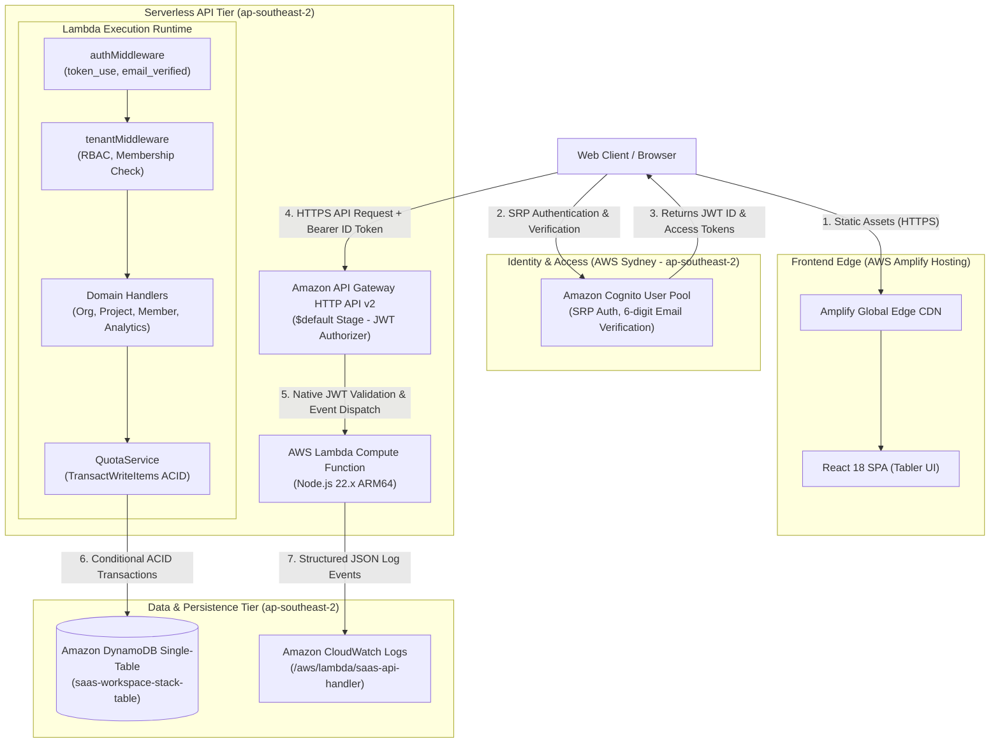
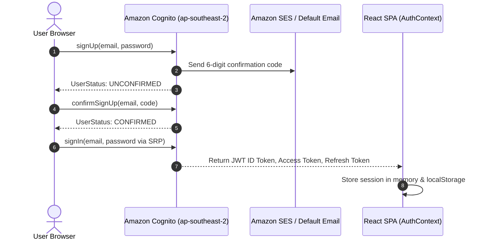
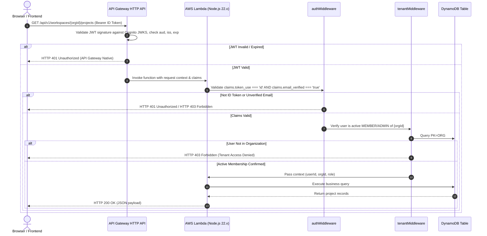
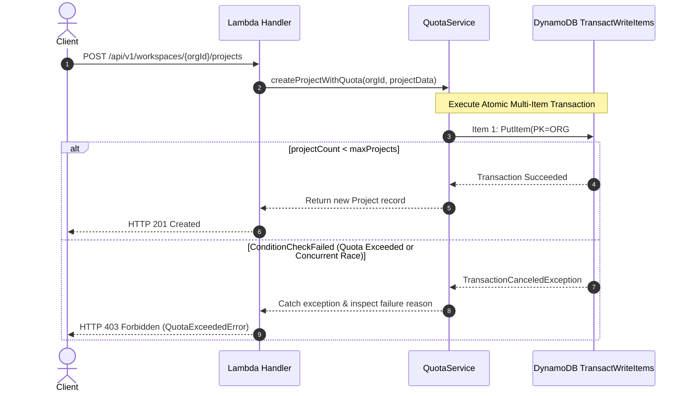
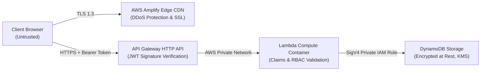

# Multi-Tenant SaaS Workspace — System Architecture Design

**Project:** Multi-Tenant SaaS Workspace with Resource Quota Management (`SaaSWorkspace`)  
**Author:** Dinesh Konda  
**Target AWS Region:** `ap-southeast-2` (Asia Pacific — Sydney)  
**Deployment Infrastructure:** 100% Native AWS Cloud (AWS Amplify Hosting + AWS SAM Serverless)  

---

## Table of Contents
1. [Architectural Overview & Core Principles](#1-architectural-overview--core-principles)
2. [End-to-End System Architecture](#2-end-to-end-system-architecture)
3. [Identity & Authentication Architecture](#3-identity--authentication-architecture)
4. [Authenticated API Request Flow & Claims Inspection](#4-authenticated-api-request-flow--claims-inspection)
5. [Amazon DynamoDB Single-Table Design](#5-amazon-dynamodb-single-table-design)
6. [Atomic Resource Quota Management Engine](#6-atomic-resource-quota-management-engine)
7. [Resumable 7-Step Cascading Deletion Engine](#7-resumable-7-step-cascading-deletion-engine)
8. [Tenant Isolation Model & RBAC Matrix](#8-tenant-isolation-model--rbac-matrix)
9. [Trust Boundaries & Security Controls](#9-trust-boundaries--security-controls)
10. [Failure Modes & Architectural Mitigations](#10-failure-modes--architectural-mitigations)

---

## 1. Architectural Overview & Core Principles

The Multi-Tenant SaaS Workspace architecture is engineered around four core cloud principles:

1. **Serverless Scale-to-Zero:** All backend components (AWS Lambda, Amazon API Gateway, Amazon Cognito, Amazon DynamoDB) incur zero idle compute charges, automatically scale with traffic spikes, and require no physical or virtual server administration.
2. **Logical Partition-Level Tenant Isolation:** Tenancy is enforced at the database storage layer through partition key prefixing (`ORG#<orgId>`). Cross-tenant data leakage is architecturally prohibited without explicit organizational authorization.
3. **Decentralized Concurrency & ACID Quota Guarantees:** Resource creation limits are enforced atomically via DynamoDB `TransactWriteItems` with condition expressions (`projectCount < maxProjects`, `memberCount < maxMembers`). This eliminates race conditions without distributed lock managers.
4. **Defense in Depth:** Multiple independent security boundaries validate every transaction: API Gateway JWT authorizer signature verification, backend `authMiddleware` claim inspection (`token_use === 'id'`), tenant-level membership checks, and least-privilege IAM roles.

---

## 2. End-to-End System Architecture

---

## 3. Identity & Authentication Architecture

Authentication is powered by **Amazon Cognito User Pools** configured with a public web client (`GenerateSecret: false`) operating the **Secure Remote Password (SRP)** protocol via AWS Amplify Auth v6.

### Key Security Decisions:
- **No Client Secret:** Because the frontend is a client-side Single Page Application running in the user's browser, embedding a client secret would expose it. The SRP protocol mathematically proves knowledge of the password without transmitting it over the wire.
- **Email Verification Mandate:** Accounts remain in `UNCONFIRMED` status until the 6-digit code sent to the user's email address is submitted. Unverified users cannot execute authenticated workspace API operations.

---

## 4. Authenticated API Request Flow & Claims Inspection

---

## 5. Amazon DynamoDB Single-Table Design

The entire application relies on a single DynamoDB table (`saas-workspace-stack-table`) using overloaded partition and sort keys to represent heterogeneous entities while guaranteeing atomic transactional boundaries.

### 5.1 Primary Keys & Secondary Indexes
- **Primary Key:** `PK` (Partition Key, String), `SK` (Sort Key, String)
- **Global Secondary Index 1 (`GSI1`):** `GSI1PK` (String), `GSI1SK` (String) — Inverts user-to-organization relationships.
- **Global Secondary Index 2 (`GSI2`):** `GSI2PK` (String), `GSI2SK` (String) — Supports organization invite resolution.

### 5.2 Single-Table Entity Mapping Matrix

| Entity | PK | SK | GSI1PK | GSI1SK | Attributes & Purpose |
|:---|:---|:---|:---|:---|:---|
| **User Profile** | `USER#<userId>` | `PROFILE` | — | — | `userId`, `email`, `name`, `createdAt` |
| **Organization Metadata** | `ORG#<orgId>` | `METADATA` | — | — | `name`, `tier`, `maxProjects`, `maxMembers`, `projectCount`, `memberCount`, `adminCount`, `status`, `authorizedAdminIds`, `createdAt` |
| **Organization Membership** | `ORG#<orgId>` | `MEMBER#<userId>` | `USER#<userId>` | `ORG#<orgId>` | `role` (`ADMIN` \| `MEMBER`), `email`, `joinedAt` |
| **Project** | `ORG#<orgId>` | `PROJECT#<projectId>` | — | — | `name`, `description`, `createdBy`, `createdAt`, `updatedAt` |
| **Invite Pointer** | `ORG#<orgId>` | `INVITE#<code>` | — | — | Pointer item enabling cascade deletion of invites when an org is deleted |
| **Invite Metadata** | `INVITE#<code>` | `METADATA` | `ORG#<orgId>` | `INVITE#<code>` | `orgId`, `role`, `expiresAt`, `usedCount`, `maxUses`, `createdBy` |
| **Audit Log Event** | `ORG#<orgId>` | `AUDIT#<isoTimestamp>#<id>` | — | — | `action`, `actorUserId`, `actorEmail`, `targetId`, `timestamp`, `details` |

---

## 6. Atomic Resource Quota Management Engine

Resource quotas protect cloud infrastructure and ensure multi-tenant fair sharing. Unlike distributed locks that introduce latency and deadlocks, SaaSWorkspace enforces quotas at the database storage engine using **DynamoDB `TransactWriteItems`**.

### Verified Quota Tiers

| Tier | Maximum Projects | Maximum Members | Suitable Workload |
|:---|:---:|:---:|:---|
| **Free** | 10 | 5 | Evaluation, student projects, individual proof-of-concept |
| **Standard** | 50 | 25 | Small teams, active cross-functional departments |
| **Premium** | 200 | 100 | Enterprise departments, high-volume production workspaces |

---

## 7. Resumable 7-Step Cascading Deletion Engine

Deleting an organization requires safely cleaning up all associated projects, members, invites, and audit logs without leaving orphaned items or exceeding DynamoDB transaction limits. The backend implements a resumable 7-step deletion engine:

1. **Step 1: Mark Organization Status as DELETING:** Updates `ORG#<orgId> / METADATA` status attribute to `DELETING`. Subsequent read/write operations on this workspace immediately fail with HTTP 403.
2. **Step 2: Delete Workspace Projects:** Queries all `SK` starting with `PROJECT#` and batches deletions in chunks of 25 items (`BatchWriteItem`).
3. **Step 3: Delete Workspace Invites:** Queries all `SK` starting with `INVITE#`, resolves both the pointer and the global invite metadata item, and executes batch deletions.
4. **Step 4: Delete Workspace Memberships:** Queries all `SK` starting with `MEMBER#` and removes membership records.
5. **Step 5: Delete Workspace Audit Trail:** Removes historical audit records associated with the tenant.
6. **Step 6: Remove Organization Metadata:** Deletes the primary `ORG#<orgId> / METADATA` record.
7. **Step 7: Verification & Finalization:** Confirms zero remaining items under `PK=ORG#<orgId>` and emits final deletion log metrics.

---

## 8. Tenant Isolation Model & RBAC Matrix

### Logical Isolation Guarantee
Every tenant's data is isolated through the partition key prefix `ORG#<orgId>`. Because DynamoDB queries must specify an exact Partition Key value, one tenant cannot read, scan, or modify another tenant's records without knowing and supplying that partition key. Furthermore, the `tenantMiddleware` checks that the authenticated user's ID exists in that specific organization's membership table before allowing any query to proceed.

### Role-Based Access Control (RBAC) Matrix

| Operation | Anonymous | Member | Admin | Owner / Creator |
|:---|:---:|:---:|:---:|:---:|
| User Registration & Email Verification | :white_check_mark: | :white_check_mark: | :white_check_mark: | :white_check_mark: |
| View User Profile | :x: | :white_check_mark: | :white_check_mark: | :white_check_mark: |
| Create New Organization | :x: | :white_check_mark: | :white_check_mark: | :white_check_mark: |
| View Organization Projects | :x: | :white_check_mark: | :white_check_mark: | :white_check_mark: |
| Create / Edit / Delete Projects | :x: | :white_check_mark: | :white_check_mark: | :white_check_mark: |
| View Workspace Members & Quotas | :x: | :white_check_mark: | :white_check_mark: | :white_check_mark: |
| Invite New Workspace Members | :x: | :x: | :white_check_mark: | :white_check_mark: |
| Change Member Roles | :x: | :x: | :white_check_mark: | :white_check_mark: |
| Update Workspace Settings & Quotas | :x: | :x: | :white_check_mark: | :white_check_mark: |
| Delete Workspace (Cascading) | :x: | :x: | :white_check_mark: (Last Admin Protected) | :white_check_mark: |

---

## 9. Trust Boundaries & Security Controls

1. **Client Trust Boundary:** The browser is strictly untrusted. Client-side quota checks or role restrictions are cosmetic enhancements only; the backend re-validates all permissions and quotas on every request.
2. **API Gateway Authorizer Boundary:** Rejects malformed tokens, expired signatures, or forged tokens before Lambda invocation occurs, protecting backend compute from unauthorized traffic.
3. **Execution Role Boundary:** The Lambda function runs under an explicit least-privilege IAM execution role (`ApiHandlerExecutionRole`). It has no access to S3, EC2, KMS administration, or other DynamoDB tables.
4. **Data at Rest Boundary:** DynamoDB single-table data is encrypted at rest using AWS managed KMS encryption.

---

## 10. Failure Modes & Architectural Mitigations

| Failure Scenario | Impact | Architectural Mitigation |
|:---|:---|:---|
| **Concurrent Quota Race** | Multiple users create projects simultaneously when 9/10 slots are filled | DynamoDB `TransactWriteItems` with condition `projectCount < maxProjects` atomically passes one write and rejects the other with HTTP 403. |
| **Expired or Forged JWT** | Malicious client attempts API access with manipulated user ID | API Gateway JWT authorizer verifies cryptographic signature against Cognito JWKS endpoint and rejects immediately with HTTP 401. |
| **Unconfirmed User API Access** | User registers but attempts to bypass email verification | Backend `authMiddleware` checks `claims.email_verified === 'true'`. Requests fail with HTTP 403 Forbidden. |
| **Cascading Deletion Interruption** | Lambda container times out or terminates during a large workspace deletion | The 7-step deletion engine marks the org `DELETING` on step 1, blocking all new operations. Subsequent delete calls resume cleanly from remaining items. |
| **Cross-Tenant Data Tampering** | User sends orgId for a workspace they do not belong to | `tenantMiddleware` validates that a `MEMBER#<userId>` record exists for that `ORG#<orgId>` partition. Access is blocked with HTTP 403. |
| **Last Admin Demotion / Removal** | Organization could become orphaned without administrators | Handlers enforce `adminCount > 1` conditional check before permitting an Admin to be demoted or removed. |
