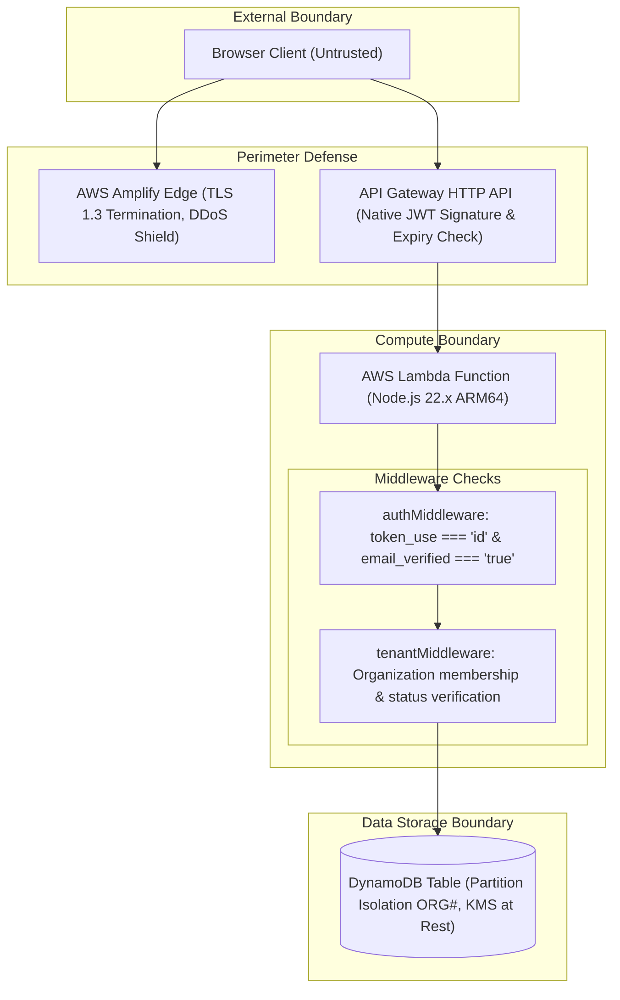

# SaaSWorkspace — Security & Threat Model

This document outlines the security architecture, threat model, and defense-in-depth controls implemented in **Multi-Tenant SaaS Workspace with Resource Quota Management** (`SaaSWorkspace`).

---

## 1. Security Architecture Principles

---

## 2. Authentication & Credential Management

- **Secure Remote Password (SRP) Protocol:** Authentication is executed via Amazon Cognito SRP flow using AWS Amplify Auth v6. Passwords are never sent across the network in plaintext.
- **No Client Secrets:** The public Cognito App Client does not utilize a client secret, preventing secret leaks in browser code.
- **Mandatory Email Verification:** Cognito user accounts remain `UNCONFIRMED` until verified via a 6-digit confirmation code.
- **Token Validation:** Backend `authMiddleware` validates:
  1. `claims.token_use === 'id'` (Access tokens are rejected).
  2. `claims.iss === expectedIssuer`.
  3. `claims.aud === expectedAudience`.
  4. `claims.email_verified === 'true'`.

---

## 3. Multi-Tenant Data Isolation

- **Partition Key Isolation:** All tenant resources share the partition key prefix `ORG#<orgId>`. Cross-tenant queries are structurally blocked by DynamoDB's key model.
- **Tenant Context Verification:** `tenantMiddleware` queries the membership record `PK=ORG#<orgId>, SK=MEMBER#<userId>` on every request. If the user does not possess an active membership in that organization, access is denied with HTTP 403 Forbidden.
- **Deletion Lockout:** When an organization is in `DELETING` status, subsequent requests to that organization are blocked.

---

## 4. Atomic Quota Enforcement & Race Condition Prevention

- **Server-Side Enforcement:** Quotas are never trusted to client-side validation alone. The backend executes `TransactWriteItems` with DynamoDB condition expressions (`projectCount < maxProjects`).
- **Atomicity:** When concurrent requests arrive, DynamoDB's transaction coordinator serializes the updates. Any request exceeding the quota fails with `TransactionCanceledException`, which is caught and returned as HTTP 403.

---

## 5. IAM Least Privilege & Infrastructure Security

- **Dedicated Execution Role:** The Lambda function does not utilize default administrator permissions. The custom IAM execution role (`ApiHandlerExecutionRole`) is strictly scoped to:
  - `dynamodb:*` restricted to the single table ARN and index ARNs.
  - `logs:CreateLogStream` and `logs:PutLogEvents` restricted to the dedicated CloudWatch log group.
- **No Private Credentials in Code:** No AWS credentials, access keys, or secrets are stored in source files, Dockerfiles, or client bundles.
